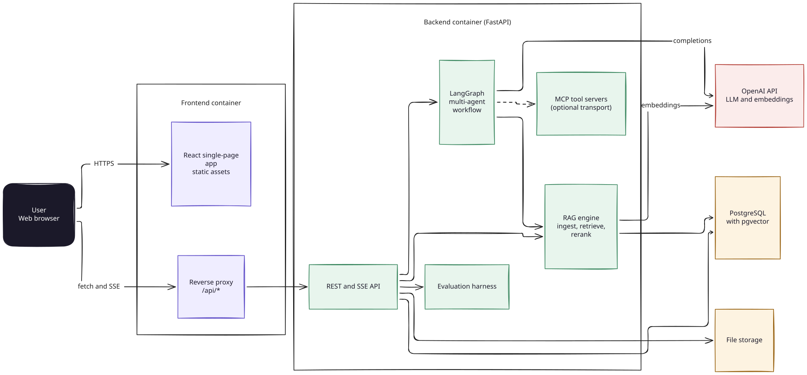
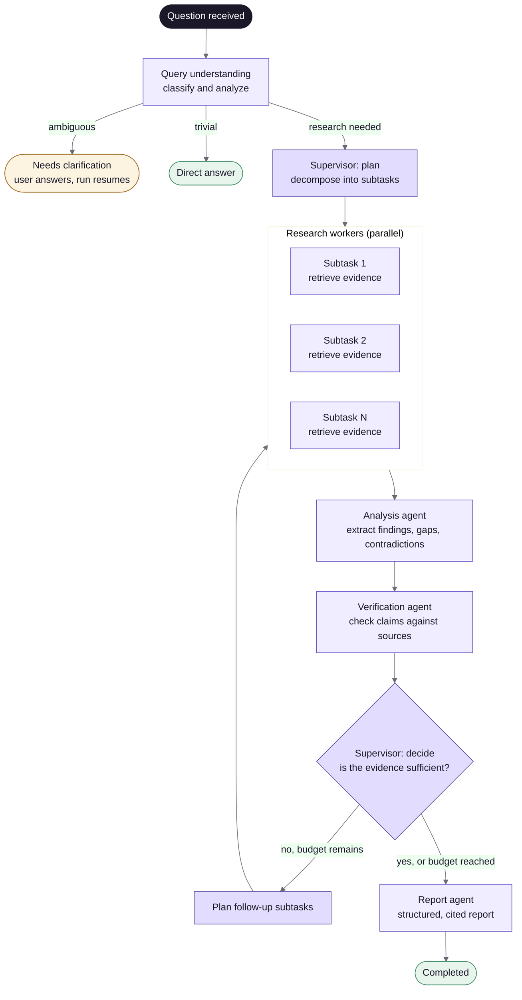
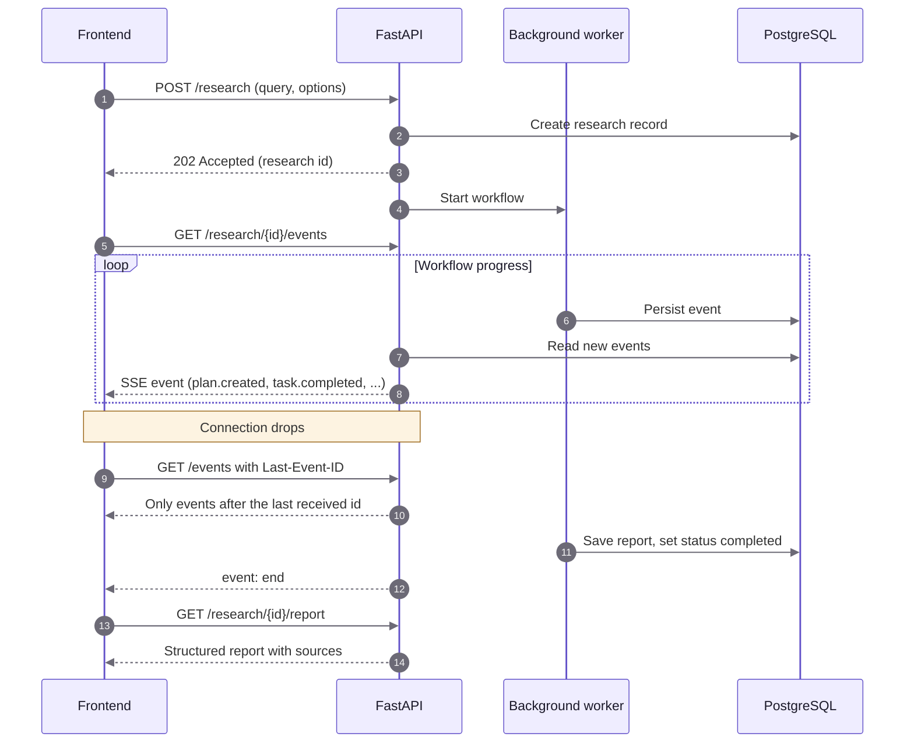

# Agentic Research System

A multi-agent research platform that answers complex questions from your own documents. A supervisor agent plans the work, specialized agents retrieve and analyze evidence, a verification agent checks every claim against its sources, and a report agent produces a structured, cited document. Progress streams to the browser in real time.

The system is composed of a **FastAPI + LangGraph backend** (retrieval-augmented generation over PostgreSQL and pgvector) and a **React + TypeScript frontend**.

---

## Table of contents

- [Key features](#key-features)
- [System architecture](#system-architecture)
- [How a research run works](#how-a-research-run-works)
- [Real-time progress](#real-time-progress)
- [Technology stack](#technology-stack)
- [Repository structure](#repository-structure)
- [Getting started](#getting-started)
- [Local development without Docker](#local-development-without-docker)
- [Configuration](#configuration)
- [Using the application](#using-the-application)
- [API overview](#api-overview)
- [Evaluation and experiments](#evaluation-and-experiments)
- [Testing](#testing)
- [Security and cost considerations](#security-and-cost-considerations)
- [Documentation](#documentation)
- [Troubleshooting](#troubleshooting)

---

## Key features

**Research**
- Conversational research with follow-up questions that reuse the context of the previous report.
- Multi-agent pipeline: query understanding, planning, parallel retrieval, analysis, verification, and report generation.
- Clarification requests when a question is ambiguous, and resumable runs after interruptions.
- Final reports with an executive summary, verified findings, conclusions, limitations, and source references with the original passage.

**Knowledge base**
- Upload PDF, DOCX, TXT, Markdown, and HTML documents with drag and drop.
- Asynchronous indexing with visible status (`processing`, `indexed`, `failed`), reindexing, and deletion.
- Optional restriction of a research run to specific documents.

**Retrieval**
- Vector, keyword, and hybrid search with automatic strategy selection.
- Query transformations: rewrite, multi-query, RAG Fusion, and HyDE.
- Cross-encoder reranking.

**Observability and quality**
- Live progress over Server-Sent Events, with automatic reconnection and no duplicated events.
- Token and cost tracking per research run.
- Evaluation harness with retrieval, generation, agent, and performance metrics, plus comparison of three system configurations.

---

## System architecture



The browser only communicates with the frontend container. nginx serves the static application and forwards `/api` to the backend, which removes the need for CORS configuration in the default deployment. The OpenAI credentials exist exclusively in the backend environment.

---

## How a research run works

Each question is executed by a LangGraph state machine. The supervisor can loop back for additional evidence when coverage is insufficient, within configurable iteration and token budgets.



| Agent | Responsibility |
|---|---|
| Query processor | Classifies the question, detects ambiguity, and chooses the retrieval strategy |
| Supervisor | Plans subtasks and decides whether to continue or finalize |
| Research workers | Run retrieval for each subtask and collect evidence |
| Analysis | Produces findings, identifies gaps and contradictions |
| Verification | Scores each finding against its supporting evidence |
| Report | Writes the final report in Markdown with references |

---

## Real-time progress

The backend persists every workflow event and exposes them as a Server-Sent Events stream. The frontend derives the stage indicators and agent activity exclusively from these events and reconnects automatically using the `Last-Event-ID` header.



---

## Technology stack

| Layer | Technologies |
|---|---|
| Frontend | React 19, TypeScript (strict), Vite, Tailwind CSS 4, TanStack Query, React Router, Zustand, Zod, Recharts, Vitest, React Testing Library |
| Backend | Python 3.12, FastAPI, LangGraph, LangChain, SQLAlchemy, Alembic, Pydantic |
| Data | PostgreSQL with the pgvector extension |
| Models | OpenAI chat and embedding models (configurable) |
| Tooling | Model Context Protocol (MCP) servers, optional RAGAS evaluation |
| Delivery | Docker, Docker Compose, nginx |

---

## Repository structure

```
agentic-research/
├── docker-compose.yml          # Integrated stack: database, API, web
├── docker-compose.dev.yml      # Frontend only, hot reload
├── Dockerfile                  # Frontend image (build, then nginx)
├── nginx.conf.template         # Static serving and /api reverse proxy
├── package.json
├── vite.config.ts
├── .env.example                # Frontend variables
├── docs/                       # Frontend and integration documentation
├── public/
├── src/                        # Frontend source
│   ├── app/                    # Router, providers, layout, navigation
│   ├── components/             # Shared UI components
│   ├── features/               # research, documents, evaluations, history, settings
│   ├── pages/                  # One component per route
│   ├── services/               # HTTP client, SSE client, one module per API area
│   ├── stores/                 # Connection, preferences, notifications
│   ├── types/                  # Zod schemas mirroring the backend contracts
│   ├── utils/
│   └── styles/
└── backend/
    ├── Dockerfile
    ├── docker-compose.yml      # Standalone backend stack
    ├── .env.example            # Backend variables (OpenAI key goes here)
    ├── pyproject.toml
    ├── alembic/                # Database migrations
    ├── scripts/
    ├── data/                   # Sample evaluation data
    ├── docs/                   # Backend architecture documentation
    ├── tests/
    └── src/ars/
        ├── api/                # Routes and dependencies
        ├── agents/             # Agent implementations
        ├── graph/              # LangGraph workflow
        ├── rag/                # Ingestion, parsing, chunking, validation
        ├── retrieval/          # Search strategies and reranking
        ├── evaluation/         # Metrics and experiment runner
        ├── services/
        ├── repositories/
        ├── schemas/
        └── mcp_servers/
```

---

## Getting started

### Prerequisites

- Docker 24 or later with Docker Compose v2
- An OpenAI API key

### Run with Docker Compose

1. Clone the repository and enter it.

   ```bash
   git clone <repository-url> agentic-research
   cd agentic-research
   ```

2. Create the backend environment file and add your OpenAI key.

   ```bash
   cp backend/.env.example backend/.env
   ```

   Edit `backend/.env` and set:

   ```env
   OPENAI_API_KEY=sk-...
   ```

3. Build and start the stack.

   ```bash
   docker compose up --build
   ```

   The first build downloads dependencies and can take several minutes. Database migrations are applied automatically when the API container starts.

4. Open the application at **http://localhost:8080**.

5. Go to **Documents**, upload one or more files, wait until their status is `Indexed`, and then start a new research run.

To stop the stack:

```bash
docker compose down          # keep data
docker compose down -v       # also remove the database and stored files
```

To inspect the interactive API documentation, publish the API port by uncommenting the `ports` line of the `api` service in `docker-compose.yml`, restart, and open http://localhost:8000/docs.

To enable the optional RAGAS metrics in the backend image:

```bash
WITH_RAGAS=true docker compose up --build
```

---

## Local development without Docker

Run only the database in Docker and the two applications directly on your machine.

**Requirements:** Python 3.12, [uv](https://docs.astral.sh/uv/), Node.js 20 or later.

**1. Database**

```bash
docker compose -f backend/docker-compose.yml up db
```

**2. Backend** (http://localhost:8000)

```bash
cd backend
cp .env.example .env
# In .env set OPENAI_API_KEY and, if needed, CORS_ORIGINS=["http://localhost:5173"]
uv sync
uv run alembic upgrade head
uv run uvicorn ars.api.main:app --reload --port 8000
```

**3. Frontend** (http://localhost:5173)

```bash
cp .env.example .env
npm install
npm run dev
```

To avoid configuring CORS, set the following in the frontend `.env` instead:

```env
VITE_API_BASE_URL=/api/v1
DEV_PROXY_TARGET=http://localhost:8000
```

---

## Configuration

### Backend (`backend/.env`)

| Variable | Description | Default |
|---|---|---|
| `OPENAI_API_KEY` | OpenAI credential. Required. | none |
| `API_KEY` | When set, every route except `/health` requires the `X-API-Key` header | disabled |
| `LLM_MODEL` | Generative model used by all agents | `gpt-4o-mini` |
| `EMBEDDING_MODEL` | Embedding model | `text-embedding-3-small` |
| `RETRIEVAL_STRATEGY` | `auto`, `vector`, `keyword`, or `hybrid` | `auto` |
| `RETRIEVAL_TOP_K` | Results per search | `5` |
| `MAX_ITERATIONS` | Maximum supervisor loops per run | `3` |
| `TOKEN_BUDGET` | Token budget per run | `60000` |
| `MAX_UPLOAD_MB` | Maximum upload size | `25` |
| `CORS_ORIGINS` | JSON list of allowed origins (only needed without the proxy) | `[]` |
| `DATABASE_URL` | PostgreSQL connection string | set by Compose |

The complete list is documented in `backend/.env.example`. Changing any of these values requires restarting the backend.

### Frontend (`.env`)

| Variable | Description | Default |
|---|---|---|
| `VITE_API_BASE_URL` | API base URL including `/api/v1` | `http://localhost:8000/api/v1` in development, `/api/v1` in the Docker image |
| `VITE_API_TIMEOUT_MS` | Timeout for regular requests (streaming is not limited) | `30000` |
| `DEV_PROXY_TARGET` | Development only: proxy `/api` to this backend URL | unset |

The frontend never holds OpenAI credentials. If the backend requires an API key, enter it under **Settings, Connection**. It is stored in `sessionStorage` for the current tab only.

---

## Using the application

| Section | Purpose |
|---|---|
| Dashboard | Totals, in-progress runs, indexed documents, token usage, and recent research |
| New research | Ask a question; optionally limit the search to specific documents and tune per-run parameters |
| My research | Conversations grouped with their follow-up questions |
| History | Chronological list with status filters, durations, tokens, cost, and summaries |
| Research view | Chat, live stage tracking, agent activity, and the final report |
| Documents | Upload, filter, inspect metadata, reindex, and delete |
| Evaluations | Create datasets, run experiments, and inspect metrics |
| Experiments | Compare system configurations side by side |
| Settings | Connection status, API key, default per-run parameters, and read-only backend configuration |
| Models and usage | Configured models and token consumption |

---

## API overview

All routes are served under `/api/v1`. Interactive documentation is available at `/docs` on the backend.

| Area | Endpoints |
|---|---|
| Research | `POST /research`, `GET /research`, `GET /research/{id}`, `GET /research/{id}/status`, `GET /research/{id}/report`, `GET /research/{id}/events` (SSE), `POST /research/{id}/clarifications`, `POST /research/{id}/resume` |
| Documents | `POST /documents/upload`, `GET /documents`, `GET /documents/{id}`, `DELETE /documents/{id}`, `POST /documents/{id}/reindex` |
| Evaluations | `GET` and `POST /evaluations/datasets`, `GET` and `POST /evaluations`, `GET /evaluations/{id}`, `GET /evaluations/experiments/compare` |
| System | `GET /health`, `GET /configuration` |

A detailed mapping of every frontend feature to its endpoint, including the SSE event catalog, is available in [`docs/API_INTEGRATION.md`](docs/API_INTEGRATION.md).

---

## Evaluation and experiments

The evaluation harness measures four groups of metrics:

- **Retrieval:** Recall@K, Precision@K, MRR, NDCG@K
- **Generation:** faithfulness, answer relevancy, answer correctness, context precision, context recall (lexical metrics by default, RAGAS optionally)
- **Agents:** task completion rate, tool selection accuracy, delegation accuracy, citation accuracy, evidence coverage, iterations per task, agent failure rate
- **Performance:** latency (mean, p50, p95), input and output tokens, estimated cost

Experiments run in one of four modes and can be compared against each other.

| Mode | Configuration |
|---|---|
| `retrieval` | Retrieval only, no generation |
| `A` | Conventional RAG |
| `B` | RAG with supervisor and agents |
| `C` | Multi-agent RAG with verification |

Datasets are JSON files with a list of items (`id`, `question`, `relevant_documents`, and optionally `reference_answer`, `expected_keywords`, `expected_aspects`). Sample data is provided in `backend/data/`.

---

## Testing

**Frontend**

```bash
npm install
npm test              # unit and component tests (Vitest, React Testing Library)
npm run typecheck     # strict TypeScript check
npm run build         # production build
```

The frontend tests use mocked services. They never contact the backend or OpenAI.

**Backend**

The backend includes its own test suite in `backend/tests`. Refer to `backend/README.md` for the exact commands and requirements.

---

## Security and cost considerations

- OpenAI credentials live only in `backend/.env`. Do not commit this file.
- Set `API_KEY` in the backend to require authentication on every route except the health check.
- Research runs, document indexing, and evaluation experiments call the OpenAI API and incur real cost. Experiments in modes `A`, `B`, `C` and RAGAS metrics require explicit confirmation in the interface.
- Use `TOKEN_BUDGET` and `MAX_ITERATIONS` to cap spending per run.
- The interface renders Markdown without raw HTML and never displays server stack traces or internal exception text.
- Uploaded files are validated by extension, size, and actual content type before processing.

---

## Documentation

| Document | Content |
|---|---|
| [`docs/API_INTEGRATION.md`](docs/API_INTEGRATION.md) | Feature-to-endpoint mapping, SSE events, error handling, CORS |
| [`docs/FRONTEND_ARCHITECTURE.md`](docs/FRONTEND_ARCHITECTURE.md) | Frontend layers, design decisions, accessibility, testing approach |
| [`docs/BACKEND_GAPS.md`](docs/BACKEND_GAPS.md) | Features the current API does not expose and the proposed backend changes |
| [`backend/docs/`](backend/docs) | Backend architecture, RAG, LangGraph workflow, data model, evaluation, MCP, and cost optimization |

---

## Troubleshooting

**The page loads but every request fails.**
Check that the `api` container is healthy with `docker compose ps` and inspect its logs with `docker compose logs api`. A missing or invalid `OPENAI_API_KEY` is the most common cause of failed research runs.

**CORS errors in the browser console during local development.**
Either set `CORS_ORIGINS=["http://localhost:5173"]` in `backend/.env` and restart the backend, or use the Vite proxy configuration described above.

**HTTP 401 responses or an authentication banner.**
The backend has `API_KEY` configured. Enter the same value under Settings, Connection.

**A document stays in `Processing`.**
Indexing runs in the background and requires embeddings from OpenAI. Check the API logs. Failed documents show the reason in their detail panel and can be reindexed.

**File upload is rejected.**
Verify the format (PDF, DOCX, TXT, Markdown, HTML) and the size against `MAX_UPLOAD_MB`. If you changed that value, also raise `client_max_body_size` in `nginx.conf.template`.

**Live progress does not update behind a custom proxy.**
The proxy must disable response buffering for the `/api/` location. The provided nginx configuration already does this.