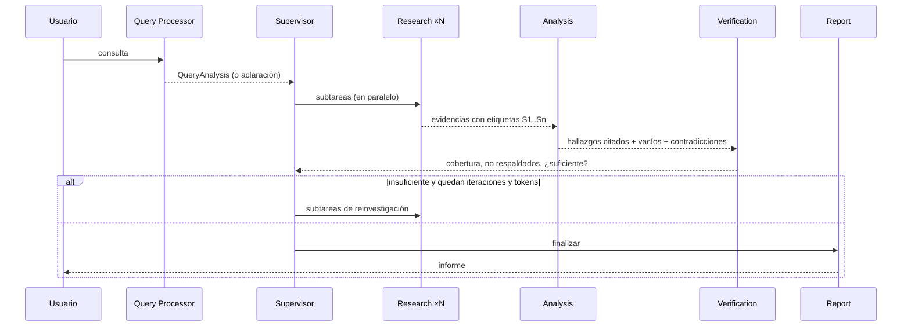

# Agentes

Todos comparten el mismo `LLMGateway` (modelo único) y reciben un `ExecutionRecord` donde se anotan tokens, llamadas y herramientas (se guarda como `AgentExecution`).

## Query Processor (`query/processor.py`)
`looks_clear()` decide con reglas baratas (longitud, mayúscula inicial, puntuación final, sin referencias vagas). Si está clara → análisis heurístico **sin LLM**. Si no, una llamada con esquema `QueryUnderstanding` (corrige ortografía sin cambiar la intención, extrae entidades/restricciones, marca ambigüedad con ≤3 preguntas). Con aclaración pendiente la investigación queda `needs_clarification` y se reanuda con `POST /research/{id}/clarifications`. Modo configurable: `QUERY_PROCESSOR_MODE=auto|always|never`.

## Supervisor (`agents/supervisor.py`)
- **plan**: para preguntas simples (un aspecto, tipo descriptivo/factual) crea 1 subtarea sin LLM; si no, pide un `ResearchPlan` (máx. `MAX_SUBTASKS`, duplicados eliminados).
- **decide** (reglas, orden de prioridad): suficiente → finalizar · reinvestigación desactivada → finalizar · `MAX_ITERATIONS` → finalizar · tokens insuficientes → finalizar · nuevas subtareas a partir de los *vacíos* detectados y de las subtareas sin cobertura (reintento con `rag_fusion`, una sola vez) · sin nada nuevo → finalizar. La decisión es un `SupervisorDecision` estructurado.

## Research Agent (`agents/research.py`)
Ejecuta una subtarea con la herramienta `retrieve` (router + transformaciones + híbrida + reranking). Si no hay resultados reintenta una vez en modo híbrido. Devuelve `TaskResult` con evidencias (documento, página, fragmento, puntuación), consultas usadas y errores. Un fallo de una subtarea **no** tumba la iteración.

## Analysis Agent (`agents/analysis.py`)
Recibe evidencias etiquetadas (`<evidence id="S1">`), el plan y los hallazgos previos; devuelve `AnalysisOutput`: hallazgos (`fact` | `interpretation`, con etiquetas), coincidencias, contradicciones, vacíos y ≤3 conclusiones preliminares. La selección y el etiquetado de evidencias (`agents/evidence.py`) son deterministas y reparten el presupuesto de caracteres entre subtareas.

## Verification Agent (`agents/verification.py`)
Para cada afirmación fáctica: etiquetas inexistentes se descartan; sin evidencia citada → `unsupported`; solapamiento léxico ≥ umbral → `supported`; el resto va **en una sola llamada por lotes** al LLM, que solo ve el texto citado y debe responder `supported|partially_supported|unsupported|contradicted`. Si el LLM no está disponible (presupuesto/fallo) se degrada a criterios léxicos: **nunca** se marca como respaldado algo sin evidencia. Calcula cobertura por subtarea, ratio de no respaldados y `sufficient`.

## Report Agent (`agents/report.py`, `report_render.py`)
El LLM redacta título, resumen, objetivo, secciones, comparaciones, conclusiones y limitaciones. El código añade **metodología real** (iteraciones, estrategias, cifras), la **clasificación** (hechos respaldados / interpretaciones / no verificados), las **referencias** y las limitaciones objetivas (límite de iteraciones, presupuesto, contradicciones, errores). Las citas inexistentes se eliminan y se cuentan (`citation_validity`). Si el LLM falla o no hay presupuesto, se genera un informe determinista degradado.

## Herramientas por agente
Lista cerrada (`agents/toolbox.py`): solo el Research Agent puede recuperar. Ningún agente ejecuta código ni accede a archivos o red arbitrarios.
