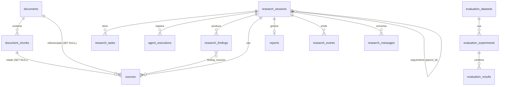

# Modelo de datos (PostgreSQL 17 + pgvector)

| Tabla                                                                   | Contenido y notas                                                                                                                                                                                 |
| ----------------------------------------------------------------------- | ------------------------------------------------------------------------------------------------------------------------------------------------------------------------------------------------- |
| `documents`                                                             | Nombre (único), tipo, título, autor, fecha, tamaño, `content_hash` (único), `storage_path`, `version`, `status`, `index_signature`, `num_chunks`…                                                 |
| `document_chunks`                                                       | Texto, `chunk_index`, `page_number`, `embedding vector(N)`, `search_vector tsvector` (columna **generada**). Índices: HNSW (coseno), GIN (FTS), `document_id`. `UNIQUE(document_id, chunk_index)` |
| `embedding_cache`                                                       | `(content_hash, model, dimensions)` → vector. Evita reembeber textos repetidos                                                                                                                    |
| `research_sessions`                                                     | Consulta, `normalized`, `options`, `status`, `current_stage`, `stop_reason`, tokens, `cost_usd`, `run_count`, `parent_id`                                                                         |
| `research_tasks`                                                        | Subtareas: pregunta, estrategia usada, consultas, nº de evidencias. `UNIQUE(research_id, key)`                                                                                                    |
| `agent_executions`                                                      | Una fila por ejecución de agente: tokens, llamadas LLM, latencia, herramientas, error                                                                                                             |
| `sources`                                                               | Evidencia citada (etiqueta `S#`, fragmento, página, puntuación). `UNIQUE(research_id, label)`. Guarda `document_name` como instantánea                                                            |
| `research_findings` + `finding_sources`                                 | Hallazgos con `kind`, `support_level`, nota; relación N:M con fuentes                                                                                                                             |
| `reports`                                                               | Markdown, contenido estructurado, calidad. 1:1 con la investigación                                                                                                                               |
| `research_events`                                                       | Eventos de progreso (SSE) con `id` autoincremental                                                                                                                                                |
| `research_messages`                                                     | Historial conversacional                                                                                                                                                                          |
| `evaluation_datasets` / `evaluation_experiments` / `evaluation_results` | Datasets (JSONB), experimentos (modo, config, resumen) y resultados por ítem                                                                                                                      |

Tablas auxiliares respecto al mínimo pedido: `embedding_cache`, `research_events`, `research_messages`, `finding_sources`. Además, las tablas de checkpoints de LangGraph (`checkpoints*`) las crea `PostgresSaver.setup()`, no Alembic.

## Decisiones

- **Borrado**: borrar un documento elimina sus chunks (`ON DELETE CASCADE`); las fuentes de informes antiguos conservan nombre y fragmento (FKs `SET NULL`).
- **Dimensión del vector**: se fija en la migración desde `EMBEDDING_DIMENSIONS`. HNSW admite hasta 2000 dimensiones: con `text-embedding-3-large` usa `dimensions=1536` (el servicio ya lo envía a la API para los modelos `text-embedding-3-*`). Al arrancar y en `/health` se comprueba que la columna coincide con la configuración. Cambiar modelo/dimensión exige nueva migración + reindexar todo.
- **FTS `simple`**: neutral al idioma, sin _stemming_. Cambiarlo implica modificar la columna generada en una migración.
- **Migraciones**: `alembic upgrade head` (0001). Existe una prueba de integración que compara el esquema migrado con los modelos (`tests/persistence`).
- **JSONB** para datos semiestructurados (opciones, métricas, payloads de eventos); lo relacional se mantiene en columnas.
