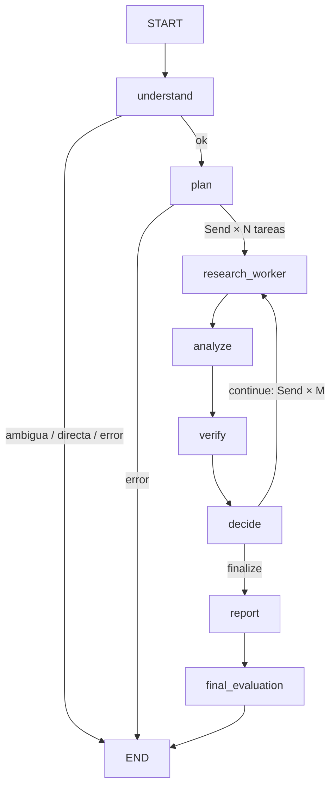

# LangGraph: flujo, estado y memoria

## Grafo (`graph/builder.py`)

| Nodo | Agente | Escribe en el estado |
|---|---|---|
| `understand` | Query Processor | `analysis`, `status` (clarificación/directa) |
| `plan` | Supervisor | `tasks`, `pending`, `iteration` |
| `research_worker` | Research (N en paralelo) | `task_results` |
| `analyze` | Analysis | `sources`, `findings`, `analysis_notes` |
| `verify` | Verification | `findings` (con `support`), `verification` |
| `decide` | Supervisor | `decision`, `tasks`/`pending`/`iteration` si continúa |
| `report` | Report | `report` |
| `final_evaluation` | (determinista) | `quality`, `status` |

## Paralelismo con `Send`
`fan_out` devuelve un `Send("research_worker", {"tasks": [t], "iteration": n})` por subtarea. LangGraph ejecuta los workers en el mismo superpaso y **espera a todos** antes de `analyze`. Los resultados se combinan con reducers: `task_results` (`operator.add`) y `sources` (`merge_sources`, une `task_ids` y conserva la mejor puntuación). En modo secuencial (experimento B) se envía un único `Send` con todas las tareas.

## Estado compartido (`graph/state.py`)
`ResearchState` es un `TypedDict` con reducers. Todo el contenido es serializable (dicts/listas/cadenas) para poder guardarlo en checkpoints. Los objetos no serializables (LLM, tracker, toolbox) se inyectan **por cierre** al construir el grafo para cada ejecución, no viven en el estado.

## Control de iteraciones, errores y presupuesto
- `MAX_ITERATIONS`, `MAX_SUBTASKS`, `MAX_FOLLOWUP_TASKS` y `recursion_limit` (`GRAPH_RECURSION_LIMIT`) acotan el ciclo.
- Cada nodo captura sus errores: un fallo del análisis o de la verificación no aborta; se registra en `errors`, se marca `analysis_failed` y el Supervisor finaliza. Solo los fallos de `understand`, `plan` o `report` terminan en `failed`.
- `BudgetExceededError` → `budget_exhausted`; el informe usa la **reserva** (`REPORT_RESERVE_RATIO`) y, si tampoco alcanza, se genera un informe determinista.

## Memoria y contexto
| Nivel | Dónde | Para qué |
|---|---|---|
| **Memoria de ejecución** | Estado del grafo + checkpoints (`PostgresSaver`, `thread_id = <research_id>-<run>`) | Colaboración entre agentes; reanudar tras un corte (`/resume`). |
| **Persistencia de investigaciones** | Tablas `research_*`, `sources`, `reports` | Consultar planes, evidencias, hallazgos e informes después. |
| **Historial conversacional** | `research_messages` + `parent_research_id` | Seguimientos: se transmite solo título + resumen del informe previo (≤1200 car.). |

`messages` guarda **notas compactas** entre agentes (no los prompts completos). `graph/context.py` aplica: **filtrar** por emisor (`filter_messages`), **recortar** por tokens (`trim_messages` con `count_tokens_approximately`) y **modificar** el historial eliminando mensajes antiguos con `RemoveMessage` al final de cada iteración (`MESSAGE_KEEP_LAST`). Cada agente recibe solo lo que necesita: el analista ve notas del supervisor/verificación; el informe solo ve hallazgos y referencias.

## Checkpointing
`PostgresSaver` (pool con `autocommit=True`, `row_factory=dict_row`, `prepare_threshold=0`) se crea una vez en `AppContainer` y `setup()` crea sus tablas. Desactivable con `CHECKPOINTING_ENABLED=false`. Las evaluaciones usan ejecuciones sin checkpointer.

## Por qué no más complejidad
Un único patrón (Supervisor–Worker), un único tipo de worker paralelizado y reglas deterministas en la decisión: suficiente para el caso de uso y más fácil de depurar que una jerarquía o un enjambre.
