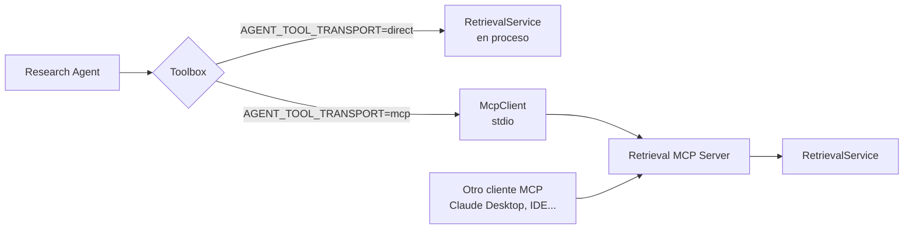

# MCP (Model Context Protocol)

Se usa el SDK oficial (`mcp`, `FastMCP`). Hay **tres servidores independientes**, cada uno en su propio proceso y con su propio `AppContainer` (sin pool de trabajos ni checkpointer).

| Servidor     | Módulo                              | Herramientas                                                                                  |
| ------------ | ----------------------------------- | --------------------------------------------------------------------------------------------- |
| Documentos   | `ars.mcp_servers.document_server`   | `search_documents`, `get_document_content`, `get_document_metadata`, `list_documents`         |
| Recuperación | `ars.mcp_servers.retrieval_server`  | `vector_search`, `keyword_search`, `hybrid_search`, `rerank_documents`, `get_relevant_chunks` |
| Evaluación   | `ars.mcp_servers.evaluation_server` | `evaluate_retrieval`, `evaluate_answer`, `compare_experiments`, `get_evaluation_metrics`      |

Entradas con restricciones (`Annotated[..., Field(ge=, le=, min_length=)]`) y salidas con modelos Pydantic (`mcp_servers/schemas.py`) que el SDK publica como `inputSchema`/`outputSchema`.

## Transportes

- **stdio** (por defecto): el cliente lanza el servidor como subproceso. Los logs van a **stderr** porque stdout es el canal del protocolo.
- **streamable-http**: `MCP_TRANSPORT=streamable-http MCP_PORT=8002`; en Compose, `docker compose --profile mcp up` (puertos 8001–8003).

```bash
uv run python -m ars.mcp_servers.retrieval_server        # stdio
MCP_TRANSPORT=streamable-http MCP_PORT=8002 uv run python -m ars.mcp_servers.retrieval_server
```

## Cómo se conectan los agentes



- **Por defecto** los agentes llaman a los servicios Python directamente: añadir un proceso y serialización a cada búsqueda interna solo costaría latencia.
- Con `AGENT_TOOL_TRANSPORT=mcp`, `McpToolbox` (en `agents/toolbox.py`) usa `McpClient` (`mcp_servers/client.py`) para llamar a `get_relevant_chunks`. Cada llamada abre una sesión stdio: es **más lento**, y el servidor MCP no recibe el LLM de la investigación, por lo que no aplica transformaciones de consulta con LLM (por eso fuerza `transform="none"`) ni cuenta embeddings en el presupuesto.
- Cualquier cliente MCP externo (un IDE, otro agente) puede usar los mismos servidores, que es el valor real de MCP aquí: interoperabilidad.

## Seguridad

Los servidores son de solo lectura salvo `evaluate_retrieval` (crea un experimento). El texto de documentos devuelto es **dato no confiable**: los clientes no deben tratarlo como instrucciones. No exponen ejecución de código ni acceso al sistema de archivos. En HTTP no hay autenticación: no los publiques fuera de una red de confianza.
