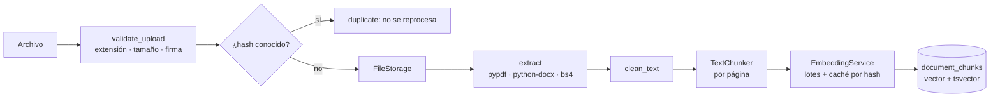
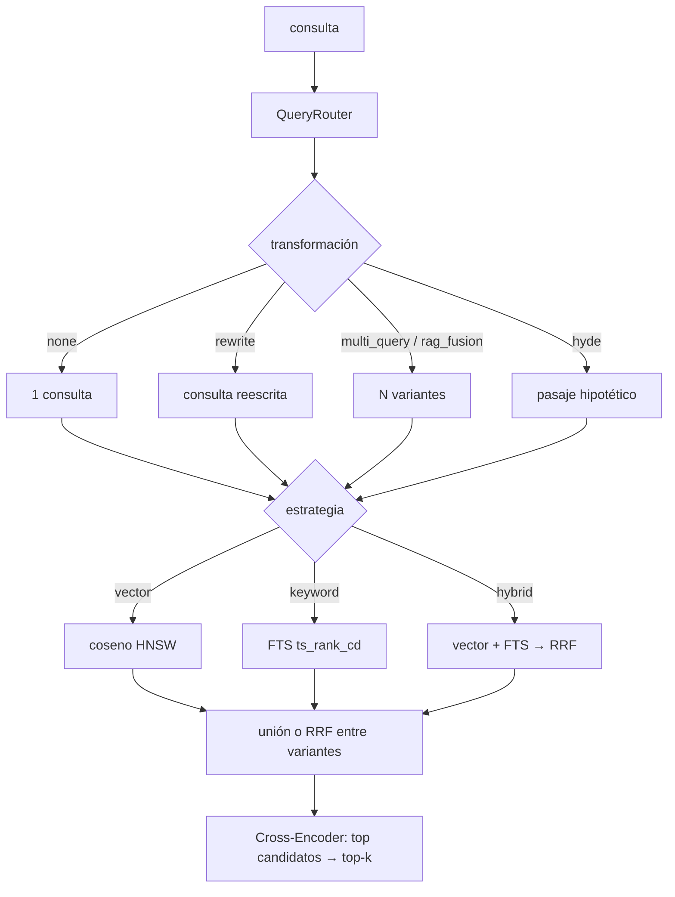

# RAG: indexación y recuperación

## Indexación (`rag/`)

1. **Recepción y validación** (`validation.py`): extensión permitida (`pdf, docx, txt, md, html`), tamaño (`MAX_UPLOAD_MB`), firma real (`%PDF-`, ZIP con `word/document.xml`, sin bytes NUL en texto), protección _zip bomb_ (`MAX_UNCOMPRESSED_MB`), límite de páginas PDF, nombre saneado.
2. **Extracción** (`loaders.py`): PDF por página (con número de página y metadatos), DOCX (párrafos + tablas + propiedades), HTML (se eliminan `script/style/iframe`), Markdown (título = primer H1), TXT (UTF‑8 con _fallback_ latin‑1).
3. **Limpieza** (`cleaning.py`): NFKC, caracteres de control, palabras partidas por guion, espacios.
4. **Chunking** (`chunking.py`): `recursive` (por defecto), `fixed` o `sentence`; tamaño, solapamiento y separadores configurables. Se divide **página a página** para conservar el número de página.
5. **Embeddings** (`embeddings.py`): `OpenAIEmbeddings` en lotes (`EMBEDDING_BATCH_SIZE`); textos repetidos se embeben una vez; caché persistente por `(hash, modelo, dimensiones)`.
6. **Almacenamiento**: los chunks antiguos se sustituyen por los nuevos **en una única transacción**.
7. **Versiones y cambios**: el hash SHA‑256 del contenido detecta duplicados (mismo hash → no se procesa) y modificaciones (mismo nombre, otro hash → `version + 1`). `index_signature` (chunking + modelo + limpieza) permite saber si hay que reindexar: `POST /documents/{id}/reindex` no hace nada si el índice está al día (salvo `?force=true`).

### Cómo afectan tamaño y solapamiento a la recuperación

- **Chunks pequeños** (200–400 car.): más precisión en la coincidencia, pero pierden contexto y multiplican filas/embeddings.
- **Chunks grandes** (1500+): más contexto por fragmento, pero el embedding «promedia» varios temas y se envían más tokens al LLM.
- **Solapamiento** (10–20 %): evita cortar una idea justo en el límite; si es excesivo duplica contenido y costo.
- El valor por defecto (1000/150) es un compromiso razonable; **mídelo con tu dataset** de evaluación antes de cambiarlo, y recuerda reindexar tras el cambio.

## Recuperación (`rag/retrieval.py`)

- **Vectorial**: distancia coseno sobre `pgvector` con índice HNSW (`vector_cosine_ops`).
- **Léxica**: PostgreSQL FTS (`to_tsvector('simple')`, columna generada + índice GIN). La consulta se convierte en `a | b | c` con solo caracteres de palabra (sin inyección de sintaxis) y se ordena con `ts_rank_cd`. La configuración `simple` es neutral al idioma pero no hace _stemming_; para uno solo, cambia la configuración en la migración y el modelo.
- **Híbrida + RRF**: `score(d) = Σ 1/(k + rank_i(d))` con `k = RRF_K (60)`. Solo usa posiciones, por eso combina escalas incompatibles.
- **Transformaciones** (opcionales; nunca todas): _Rewrite‑Retrieve‑Read_ (1 consulta reescrita), _Multi‑Query_ (variantes + unión conservando la mejor puntuación), _RAG‑Fusion_ (variantes + RRF) y **HyDE** (experimental; desactivado salvo `HYDE_ENABLED=true`; la búsqueda vectorial usa un pasaje hipotético).
- **Router** (`routing.py`), reglas deterministas: comparativa → híbrida + RAG‑Fusion; consulta de ≤2 palabras → reescritura; términos específicos (siglas, cifras, frases entre comillas, identificadores) → híbrida; resto → vectorial (la más barata). Con `ROUTER_LLM_FALLBACK=true` el LLM decide solo cuando las reglas no concluyen. Lo configurado explícitamente (por petición o por entorno) prevalece.
- **Reranking**: se recuperan `top_k × RERANK_CANDIDATE_MULTIPLIER` candidatos y un cross‑encoder local (`sentence-transformers`) los reordena. Si falla la transformación se degrada a la consulta original.
- **Caché** de resultados (TTL + LRU) que se invalida al indexar o borrar documentos.
- **Filtros por metadatos**: `document_ids`, `file_types`, `author`, rango de fechas.

> Nota: el modelo de reranking por defecto es de inglés; para colecciones en español usa uno multilingüe (p. ej. `cross-encoder/mmarco-mMiniLMv2-L12-H384-v1`) mediante `RERANK_MODEL`.

## Extensiones futuras (no implementadas)

RAPTOR, MultiVectorRetriever, ColBERT, OCR para PDF escaneados, `SET hnsw.iterative_scan` cuando los filtros sean muy selectivos.
